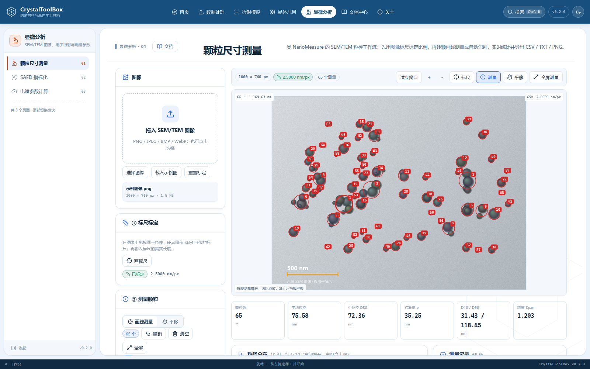
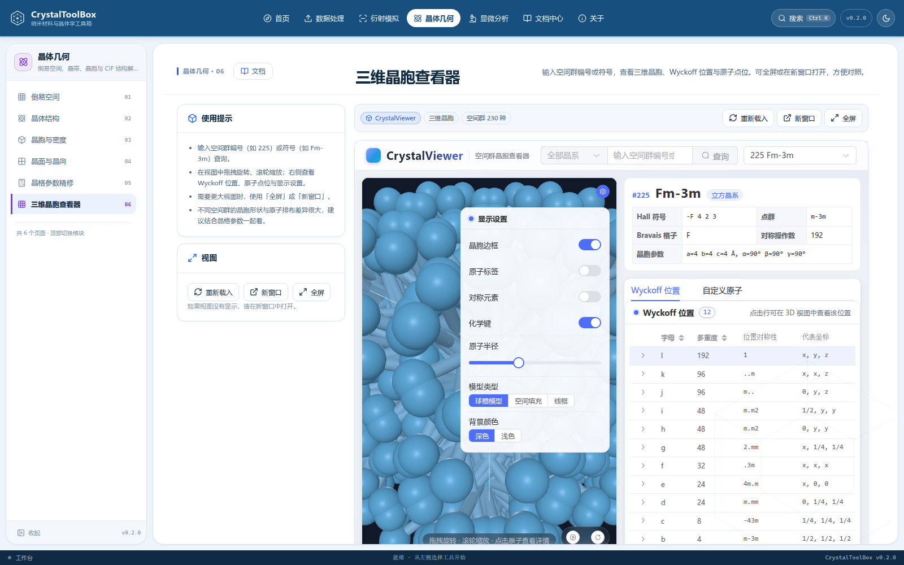

# CrystalToolBox · 纳米材料与晶体学工具箱

一个**纯前端、本地运行**的晶体学与衍射数据处理工具箱。面向纳米材料/晶体学课程与日常科研：

- 原始谱图 → 预处理 → 可逆坐标映射 → **MDI Jade** 可读的 `.xy`；
- Jade 拟合结果 `.dif` → **Origin** 多列数据，并按配方反算回原始坐标；
- 倒易空间、晶带、**SAED** 与 **XRD** 模拟，CIF 结构导入；
- **SEM/TEM 粒径统计**（类 NanoMeasure）：标尺标定、逐颗测量、自动识别、分布拟合与导出；
- **三维晶胞**：同源嵌入 CrystalViewer，按空间群浏览 3D 晶胞与 Wyckoff 位置。

无需后端、无需账号，数据不离开浏览器。

**在线地址：<https://nano.jamaccao.cn>** · **仓库：<https://github.com/lanshuye123/NanoHelper>**

浅蓝色—白色是默认主题，同时提供深色模式：






## 功能

| 模块        | 内容                                                                                             |
| ----------- | ------------------------------------------------------------------------------------------------ |
| 数据处理    | 多格式导入、列映射、裁剪/重采样/平滑/扣背底/Kα2/归一化、步骤账本、Jade 兼容性检查                |
| Jade 导出   | 两列 `.xy`、`recipe.json`、工程文件 `.xtalbox.json`                                              |
| DIF → XY    | 多块解析（Raw/Background/Fitted/Overall）、公共网格、Origin 宽表/堆叠/差值、Rp、配方反算、1/d 轴 |
| 倒易空间    | 晶格/倒易参数、d 值、晶面/晶向夹角、晶带轴、点阵消光、二维倒易面                                 |
| 电子衍射    | 带轴 SAED、结构因子强度、相机常数标定、PNG/CSV                                                   |
| XRD         | 理论谱、多重度/LP、Kα2、峰表、Scherrer、Williamson–Hall                                          |
| 晶体结构    | CIF 解析、对称展开、密度/化学式、低角反射预览、15 个预设                                         |
| 晶胞与密度  | 体积、理论密度、Z 值、APF、原子半径、由密度反算 Z、低角反射                                      |
| 晶面与晶向  | Miller/四指数、d 值、夹角、Weiss 定律、晶带、平面截距、系统消光                                  |
| 晶格精修    | 峰位最小二乘、仪器零点、标准误差、Nelson–Riley 外推                                              |
| 三维晶胞    | 内嵌 CrystalViewer：空间群、3D 晶胞、Wyckoff、显示设置                                           |
| 颗粒统计    | SEM/TEM 标尺、Feret/面积等效圆、自动识别、全屏测量、直方图、Gaussian/Log-normal、CSV/TXT/PNG     |
| SAED 指标化 | 由 R/夹角反算 d、枚举 hkl 与带轴、消光检查、候选叠加图                                           |
| 电镜参数    | 电子波长、瑞利分辨率、CTF、景深、相干长度、像差、磁透镜焦距、亮度、相机常数                      |
| 艾瓦德球    | 倒易点阵、艾瓦德球、ZOLZ/HOLZ、激发误差、厚度与倒易杆、电子/X 射线对比                            |
| 多晶衍射环  | 多晶 SAED 环、hkl/多重度/强度、实测环指标化、相机常数反算                                         |
| 对称性      | 空间群一般位置、等效位置、反射条件、系统消光、手性                                                |

## 技术栈

Vue 3 + TypeScript + Vite + Pinia + Vue Router + Element Plus；图表、衍射图与粒径分布图为自研 Canvas；公式用 KaTeX；测试用 Vitest。核心算法位于 `src/core/`，不依赖 Vue/DOM。三维晶胞查看器为同源内嵌的 CrystalViewer（Vue 3 + Three.js），构建产物位于 `public/crystal-viewer/`。

## 快速开始

```bash
npm install
npm run dev        # http://127.0.0.1:5180
```

生产构建：

```bash
npm run build
npx serve dist
```

不要直接双击 `dist/index.html`：浏览器会阻止 ES module 与示例文件 `fetch`。

## 文档

- [用户指南](docs/userguide/getting-started.md)
- [艾瓦德球](docs/userguide/ewald.md)、[多晶衍射环](docs/userguide/saed-rings.md)、[对称性](docs/userguide/symmetry.md)
- [实战手册](docs/cookbook/raman-to-jade.md)
- [功能说明](docs/reference/tools.md)
- [文件格式](docs/reference/file-formats.md)
- [公式与推导](docs/reference/formulas.md)
- [开发文档](docs/dev/architecture.md)

站内文档中心位于 `/#/docs/userguide/getting-started`，支持搜索、目录与上下篇。

## 目录

```text
src/
├─ core/        纯 TS：晶格、衍射、CIF、数据管线、IO
├─ components/  图表、布局、表单、文档
├─ views/       页面
├─ stores/      Pinia
├─ data/        元素、散射因子、空间群、预设
docs/           站点文档（Markdown，构建时打包）
tests/          Vitest 与固定装置
public/         示例数据、favicon、crystal-viewer/（内嵌 3D 晶胞）
```

## 脚本

```bash
npm run dev          # 开发服务器
npm run type-check   # vue-tsc
npm run test:unit    # Vitest
npm run build        # 类型检查 + 生产构建
npm run preview      # 预览 dist
npm run embed:cryviewer  # 从 CryViewer/dist 同步三维晶胞构建产物
```

## 部署

推送到 `main` 会触发 `.github/workflows/deploy.yml`，构建并发布到 GitHub Pages：

- 站点：<https://nano.jamaccao.cn>
- 仓库：<https://github.com/lanshuye123/NanoHelper>
- 自定义域名：`public/CNAME` → `nano.jamaccao.cn`
- Pages 源：GitHub Actions

本地构建：

```bash
npm run build
npx serve dist
```

路由为 hash 模式，不需要 404 回退。使用其他子路径时通过 `VITE_BASE_PATH=/repo/` 覆盖。详见 [构建与部署](docs/dev/deployment.md)。

## 数据来源

- 原子散射因子：Waasmaier–Kirfel 五高斯参数化（DABAX `f0_WaasKirf.dat`，源自 International Tables for Crystallography Vol. C）。
- 空间群对称操作：230 空间群标准化数据，按晶系懒加载。
- 三维晶胞：CrystalViewer（crystal.jamaccao.cn），空间群数据来自 spglib / pyxtal 导出的 International Tables 内容；本站以同源静态 iframe 嵌入。
- 课程公式与约定：与《X 射线晶体学》《显微结构分析》笔记一致；倒易空间不含 2π。
- 颗粒测量：对标 NanoMeasure 1.2 的工作流（标尺 → 逐颗测量 → 统计报告），分组采用左闭右开、末组含上限。

## 已知限制

- 三维晶胞为内嵌的 CrystalViewer，状态不与主站工具互通；结构页自身仍不画 3D；
- SAED 模拟/指标化为运动学近似，无 HOLZ/动力学；指标化只用两个斑点，存在 180° 不确定性；
- XRD 不含吸收、择优取向与仪器几何；
- 不做 Rietveld、结构解析；晶格精修只做峰位；
- 颗粒自动识别不做分水岭，粘连颗粒会合并；
- 不解析二进制厂商格式（`.brml`/`.raw`/`.mdi`）；
- 工程文件不包含晶体结构；自动保存仅限本机，跨设备请导出工程文件。

## 许可

代码以 MIT 许可发布；第三方数据遵循其原始许可。详见 `LICENSE`。
